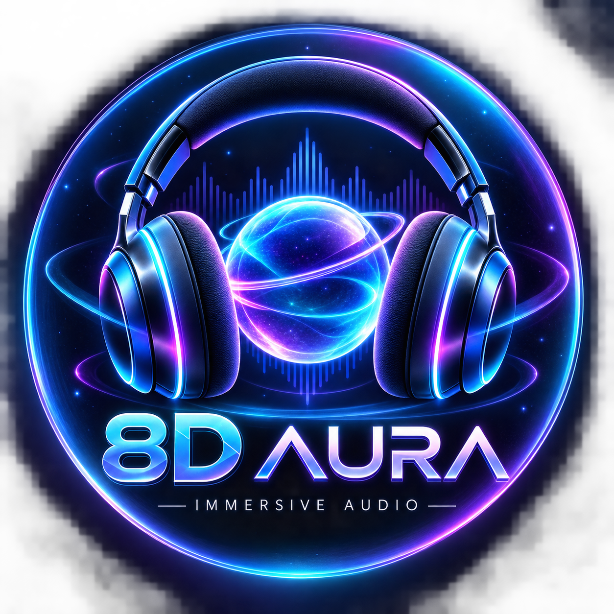
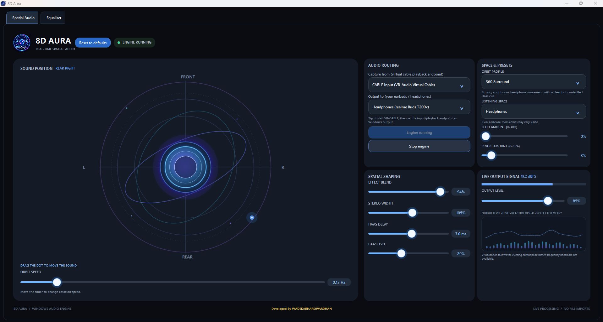
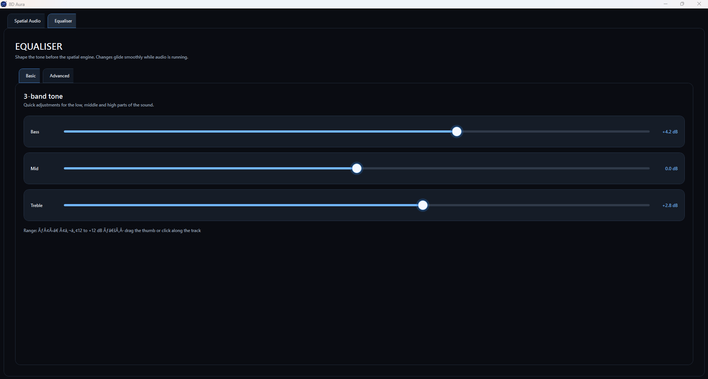

<p align="center">
  
</p>

<h1 align="center">8D Aura</h1>

<p align="center">Real-time spatial audio for Windows headphones</p>

8D Aura is a Windows desktop application that captures system audio, applies a moving stereo spatial effect, and sends it to a selected playback device. It processes live audio; it does not import or save music files.

## Screenshots

### Spatial Audio


### Equaliser


## Features

- **Spatial field:** move the sound source around the orbit field or set it to rotate continuously.
- **Listening profiles:** 360 Surround, Studio Natural, Wide Atmosphere, Deep Orbit, and Vocal Clarity.
- **Listening spaces:** Headphones, Speakers, Hall, and Auditorium, with adjustable echo and room reverb.
- **Spatial controls:** effect blend, stereo width, Haas delay and level, orbit speed, and output level.
- **Equaliser:** quick Bass, Mid, and Treble controls, plus a 10-band advanced EQ with preamp, enable/disable, and reset.
- **Live feedback:** output peak meter, a level-reactive visual, and a glowing spatial orb that follows the current position and existing output level.
- **Dark WPF interface:** custom 8D Aura logo and application icon.

The visual trace and bars react to the existing output-level meter. They are not an FFT spectrum display. The spatial effect is a lightweight binaural approximation, not a measured HRTF renderer. Use stereo headphones for the intended movement; results depend on the source, devices, Windows audio configuration, and headphones.

## Requirements

- Windows 10 or 11, x64
- VB-Audio VB-CABLE for routing system playback through the app: [vb-audio.com/Cable](https://vb-audio.com/Cable/)
- .NET 8 SDK to build from source (not required for the self-contained portable publish)

## Set up audio routing

1. Install VB-CABLE and restart Windows if its installer requests it.
2. In Windows **Settings → System → Sound**, select **CABLE Input (VB-Audio Virtual Cable)** as the playback device.
3. Start 8D Aura. Select the cable playback endpoint under **Capture from** and your headphones or speakers under **Output to**.
4. Choose a profile and listening space, adjust controls to taste, then select **Start real-time 8D**.
5. When finished, stop the engine and restore your usual Windows playback device.

The app captures a Windows render endpoint using WASAPI loopback. VB-CABLE is a separate Windows audio driver and is not bundled with 8D Aura.

## Run from source

Open `8DAura.csproj` in Visual Studio 2022 with the .NET desktop development workload, or run these commands from the project folder:

```powershell
dotnet restore
dotnet run
```

## Publish a portable Windows executable

Create a self-contained, single-file x64 executable with:

```powershell
dotnet publish 8DAura.csproj -c Release -r win-x64 --self-contained true `
  -p:PublishSingleFile=true `
  -p:IncludeAllContentForSelfExtract=true `
  -p:IncludeNativeLibrariesForSelfExtract=true `
  -p:EnableCompressionInSingleFile=true `
  -p:PublishTrimmed=false `
  -o publish
```

The output is `publish/8DAura.exe`. The executable can run without installing the .NET runtime. VB-CABLE remains a separate installation.

## Built with

<p>
  <a href="https://learn.microsoft.com/dotnet/csharp/"></a>
  <a href="https://dotnet.microsoft.com/"></a>
  <a href="https://learn.microsoft.com/dotnet/desktop/wpf/"></a>
  <a href="https://github.com/naudio/NAudio"></a>
</p>

- C# and WPF on .NET 8
- NAudio for Windows audio device access and loopback capture
- WPF-native drawing and animation for the spatial orb and UI visualizations
